# Little City art guide

How to build pieces so that houses, monuments and ground all look as if one
hand drew them. Read this before you write a generator or a part. The worked
examples are real code: `scenarios/look/fixtures/` holds the spike's house,
tree, marble, pillar, stairs and lamp rebuilt with `MeshBuilder`, and every
picture here comes from `npm run shots -- 'look-*'`.

## Changes since Stage 1

Nothing below asks you to redo anything; every rule in the rest of this
guide still stands. These are things the page now does for you, and what
follows from them.

1. **Pieces are grounded by the page** (new section 11). Contact shade round
   the foot of everything, shade under anything that overhangs, a short cast
   shade on the side away from the light, a darker foot on walls. You do
   nothing, and you must not fake any of it: no dark base bands, no shadow
   quads, no darker colour under an eave. Do build real overhangs (eaves,
   awnings, balconies, arch soffits) of 0.08 or more: they now shade what is
   under them. And pieces must still really stand on the ground: the shade
   is worked out from above and does not hide a gap under a piece.
2. **Hatching lies on the surface**, in the surface's own plane, and each ink
   group gets a slightly different stroke angle. It needs nothing but correct
   normals. It no longer slides when the view orbits or zooms.
3. **The ghost preview is a pencil sketch of your piece**: a pale wash of its
   colours with pencil lines exactly where its ink lines will be (section
   4). Patterns are left out. So a piece with good ink groups previews well,
   and one with none previews as a blank shape.
4. **Terrain grass is a step lighter on each terrace above the first**, and
   has wandering patches of deeper meadow. A lawn or garden piece that should
   melt into the ground it lies on takes its colour from
   `terraceGrass(level)` in `src/style/terrain.ts` (level 1 is the lowest
   land, and is `PALETTE.grass` as before). `PALETTE.grassHigh` is new.
5. **Any style value you change redraws the town**, in the game's tuning
   panel and in the gallery. Read style values inside `build`, never at
   module load, or the redraw will not see the change.
6. **Water**: things standing in `PATTERN.water` (a dock post, a hull) get a
   soft contact shade on the water by themselves. The sea keeps its blue at
   dusk. Nothing changes in how you use the pattern.

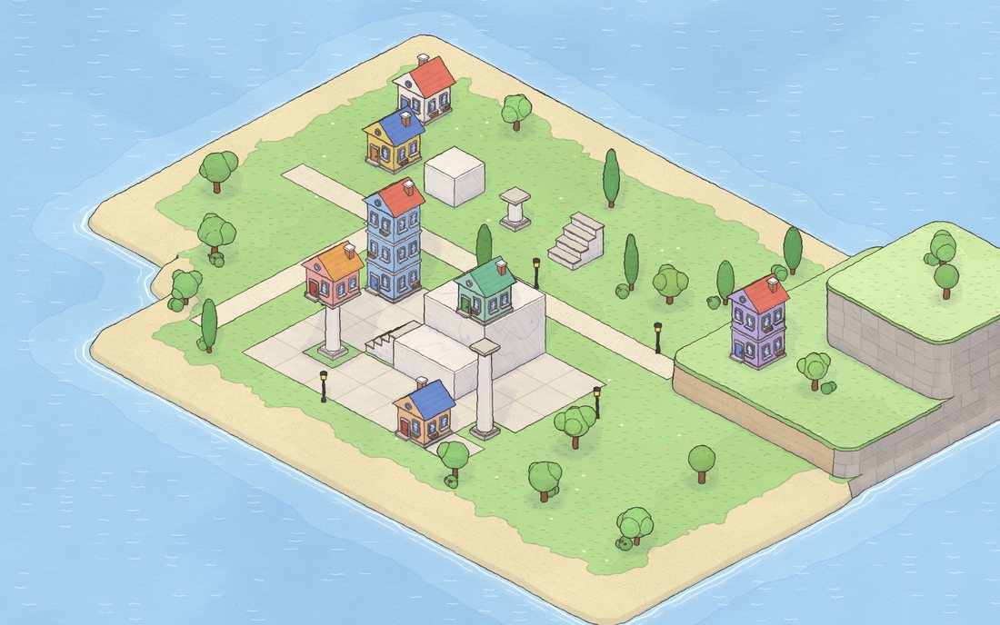

The look is **an ink-and-coloured-pencil drawing on cream paper**: flat
colour in three or four stepped tones, a dark pen line round every object,
soft pencil hatching in the shade, pencil marks for materials, paper grain
over everything. It is not lit 3D. Below, the throwaway spike (left) and the
same pieces in the engine (right).

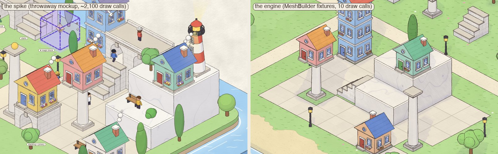

## 1. What you control, and what you do not

You emit triangles with five things on each vertex. The renderer does the
rest, the same way for every piece, which is what makes them one family.

| You set | With | It decides |
|---|---|---|
| colour | `setColor(PALETTE.x)` | the flat base colour |
| pattern | `setPattern(PATTERN.x)` | the pencil marks drawn on the surface |
| ink group | `setInk('walls')` | where pen lines fall (section 4) |
| edge | `setEdge`, `bevelTop`, `{ edge: [...] }` | a per-pattern distance: marble bevel, shore, beam fade |
| sway | `setSway(0–1)` | how much the vertex moves with the wind |

You do **not** shade, outline, hatch, light or darken anything yourself. Never
bake a shadow into a colour, never add a dark box to fake an outline, never
pick a darker colour for "the side in shade": the shader steps the tone from
the face's normal (top 100%, then 90, 79, 71, 66%, drifting cool) and hatches
the darker steps. Give it correct normals and it draws. The same goes for
the shade a piece throws on the ground and on itself (section 11).

## 2. Palette

Only colours from `src/style/palette.ts`. No hex literals in generators.

- **The body of a piece** comes from its kind's ramp and the block's palette
  index: `rampColor(s.kind, s.color)`. Houses use `RAMPS.wall` (eight
  pastels), marble, pillar, tower, arch, stairs and wall use `RAMPS.stone`,
  docks use `RAMPS.wood`.
- **Roofs**: `RAMPS.roof[...]`, picked with `rand(seed, 'roof')`. A roof is
  always clearly darker or more saturated than its walls.
- **Trim** (window frames, floor bands, chimney caps, fences): `PALETTE.white`.
  **Plinths, caps, steps, nosings**: `PALETTE.stoneShade`. **Wood**:
  `PALETTE.wood`. **Iron, lamp posts**: `PALETTE.metal`. **Brick**:
  `PALETTE.brick`. **Glass**: `PALETTE.glass` with `PATTERN.glass`.
- **Accents** (`red`, `redDark`, `yellow`, `pink`, `magic`): doors, flowers,
  flags, awnings. Small areas only. If an accent covers more than a tenth of
  a piece it is no longer an accent.
- **Plants**: `leaf`, `leafDark`, `bush`, `trunk`. Vary each plant a little
  (`vary()` in `fixtures/tree.gen.ts`: lightness ±6%, a few units warmer or
  cooler) so no two crowns match.
- **Picking neighbours**: two surfaces that touch should differ in value
  (light against mid, mid against dark), because at night hue fades and only
  value is left. White trim between a pastel wall and a strong roof is the
  house style for exactly this reason.

## 3. Proportions on the grid

A cell is 1 × 0.8 × 1 (`CELL_H = 0.8`). At a typical playing zoom one unit
is about 55 pixels, so **0.02 is one pixel**. Anything smaller than 0.03 is
noise, not detail.

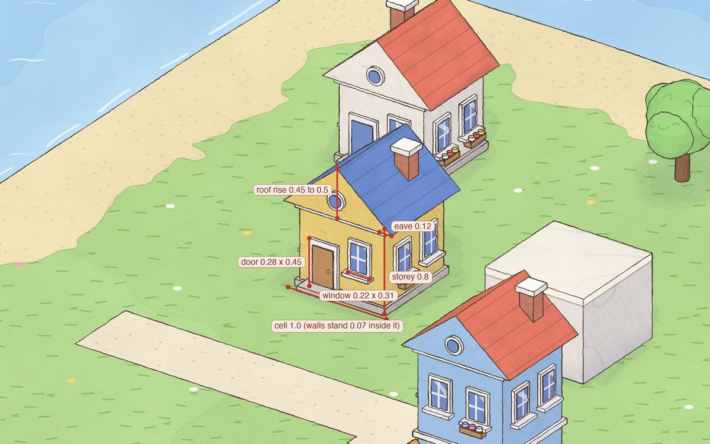

| Thing | Size (world units) |
|---|---|
| Storey | exactly `CELL_H`. Floors, decks and tops land on multiples of it, so stacks are flush. Never vary it. |
| Walls | 0.07 inside the cell edge (a 0.86 box in a 1.0 cell), so neighbours that do not merge show a gap of ink, not a z-fight |
| Plinth | 0.92 wide, 0.07 high, bottom storey only |
| Floor trim band | 0.92 wide, 0.05 high, at the top of each storey |
| Roof pitch | rise 0.45–0.5 over a half-span of 0.5 (about 42–45°) |
| Eave overhang | 0.12 past the wall; nothing reaches more than 0.12 into the next cell |
| Door | 0.28 × 0.45 in its frame, leaf 0.21 × 0.40, a step 0.36 × 0.045 × 0.16 |
| Window | frame 0.22 × 0.31, pane 0.16 × 0.25, sill 0.27 × 0.03 standing 0.08 proud; sill 0.27–0.30 above the floor |
| Relief | frames, sills, trims stand 0.03–0.08 proud of the wall. Less than 0.02 and the line vanishes. |
| Chimney | 0.14 square, 0.4 tall, a 0.19 cap |
| Pillar | shaft radius 0.15, base and capital 0.5 square |
| Fence | 0.36 high, pickets 0.07 wide, five to a cell |
| Lamp | 0.83 tall, post radius 0.03, lantern 0.12 |
| Tree | trunk 0.26–0.38 tall, crown radius 0.23–0.30, the whole plant 0.9–1.5 tall |
| Person (for scale) | 0.42 tall |

Ground: terrain tops are at `height × CELL_H`; the sea is at `SEA_Y` (0.4);
a floor piece lies 0.01–0.04 above the top it rests on. Terrace corners are
rounded, and the terrain squares a corner by itself when a block or floor
stands on that cell, so you never need to worry about overhanging a curve.

## 4. Ink lines

The renderer draws a pen line in three places and nowhere else:

1. **Silhouette**: where one thing is in front of another (a jump in depth).
2. **Seam**: where the **ink group changes** between neighbouring pixels.
3. **Crease**: where the surface turns by more than about 30° inside one group.

So you place lines by choosing ink groups and normals.

- **One object, one group.** Everything emitted under one `setInk(name)` is
  one surface: no line inside it except its creases. A wall that runs
  through five cells is one group, with the faces between the cells left out
  (`box(..., { skip: [...] })`).
- **A different object, a different group.** A window frame, a sill, a trim
  band, a chimney cap each get their own name, and so their own outline.
- **Groups are namespaced by the builder.** `new MeshBuilder({ ink: s.id })`
  makes `'walls'` on two structures two different ids, so two houses side by
  side get a line between them. A part gets `ctx.mesh()`, already namespaced
  by its item. To make a part's surface continue its host's with no seam,
  use the host's id: `b.setInkId(host.inkOf('walls'))`.
- **Round things use smooth normals** (`lathe` default, `extrude(...,
  { smooth: true })`): the tone still steps, but no crease is drawn between
  facets. Use faceted (`smooth: false`) for things that really have edges:
  a four-sided lamp cap, an octagonal tower.
- **Leave out what cannot be seen**: faces against a neighbour, bottoms on
  the ground. A doubled face z-fights and a hidden one wastes triangles.
  `findDuplicateFaces(mesh)` must be 0.
- **Do not outline small things one by one.** Sixteen thin pickets with
  sixteen groups is a black smudge. Put the pickets and rails of a fence in
  one group; put a pane and its glazing bars in one group (the bars read by
  colour). A rule of thumb: a group needs to be at least 0.06 across.
- Lines thin out by themselves when the view zooms out (seams and creases
  first), so do not design for one zoom.

```ts
// fixtures/house.gen.ts, shortened: three objects, three groups
b.with({ color: wall, pattern: PATTERN.plaster, ink: 'walls' }, () =>
  b.boxAt([0, 0, 0], [0.86, CELL_H, 0.86], { skip: ['top', 'bottom'] }));
b.with({ color: PALETTE.white, ink: `trim${y}` }, () =>
  b.boxAt([0, CELL_H - 0.05, 0], [0.92, 0.05, 0.92]));
b.with({ color: PALETTE.white, ink: `${id}-frame` }, () => {
  b.boxAt([0, 0, 0.015], [0.22, 0.31, 0.03]);       // the frame
  b.boxAt([0, -0.02, 0.05], [0.27, 0.03, 0.08]);    // and its sill: same object
});
```

## 5. Pencil patterns

A pattern is drawn by the shader in world space, so it lines up across cells
and structures without any work from you. Marks fade out when they would
shrink below a couple of pixels. Use `none` when in doubt: a plain surface
with a good outline is better than a busy one.

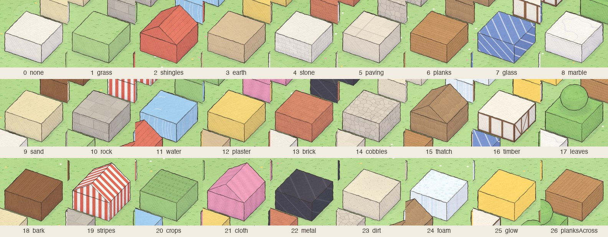

| Pattern | Use it for | Notes |
|---|---|---|
| `none` | trim, frames, caps, anything small | flat tone and hatching only |
| `grass` | lawn tops | ticks, tufts, a few flower specks. Tops only. |
| `shingles` | pitched roofs | rows follow height, so any pitch works. Not for walls or flat roofs. |
| `earth` | soil banks, the slab's side | strata and speckles; sides only |
| `stone` | ashlar walls, steps, plinths | courses 0.17 high |
| `paving` | plazas | one tile per grid cell: it shows the build grid on purpose |
| `planks`, `planksAcross` | decks, doors, benches | boards along x, or along z. Pick the one that runs along the piece. |
| `glass` | window panes | a glint by day; **lights up at dusk** (section 7). One ink group per window. |
| `marble` | marble, pillars | soft veins; a bevel line under top edges marked with `bevelTop` |
| `sand`, `dirt` | beaches, worn paths | stipple; scuffs |
| `rock` | cliffs, boulders | broken courses, each block a different tone |
| `water` | sea, ponds, basins | set `edge` to the distance from the shore for foam and shallows; leave it for still water |
| `plaster` | house walls | nearly flat; a few flecks |
| `brick` | chimneys, mills, warehouses | running bond, bricks 0.25 × 0.1 |
| `cobbles` | old streets, quays | rounded stones |
| `thatch` | cottage roofs | straw layers with a ragged edge |
| `timber` | half-timbered walls | beams on the cell lines and at each storey. The wall must be grid-aligned. |
| `leaves` | crowns, hedges | scallops; shading is softened |
| `bark` | trunks | broken upright strokes |
| `stripes` | awnings, tents, sails | bands of your colour and white, 0.125 wide |
| `crops` | vegetable beds | furrows 0.2 apart with plants |
| `cloth` | flags, laundry | soft folds |
| `metal` | lamp posts, railings | one streak of light, little hatching |
| `foam` | wakes, weirs | churned white |
| `glow` | lamp glass, lanterns | self-lit: unshaded by day, radiant at night |
| `beam` | shafts of light | translucent, never inked; `edge` runs 0 at the source to 1 at the tip |

A new pattern is a contract request: an id in `PATTERN`, a branch in
`src/render/shaders/surface.ts`, a swatch in `fixtures/swatches.gen.ts`, a
row here.

## 6. The hand: irregularity without breaking the grid

Nothing a person draws is ruler-true, so nothing here should look
extruded-by-default. All chance comes from `rand(seed, ...)` with the
structure's or item's seed: the same town always looks the same.

| Vary | By about | Never vary |
|---|---|---|
| lean of a whole small piece (`rotateZ`) | up to 0.015 rad (trunks up to 0.07) | the footprint: walls stay on their grid lines |
| height of windows, sills, signs | ±0.01 | storey height, deck and top levels |
| roof rise, chimney place, eave | ±0.03 | anything that must meet a neighbour |
| size of plants and props | ±12% | sockets: a door stays where its socket is |
| spacing of repeated things (pickets, flowers) | ±10% of the gap | |
| colour of plants, roof tiles, single stones | ±6% lightness | wall colour within one structure |
| which variant (flower box or not, chimney left or right) | free | |

Add character with **objects**, not with noise: a flower box, a step, a
bracket, a lean-to. Three or four small objects per storey is the density of
the reference art; ten is clutter.

## 7. Dusk and night

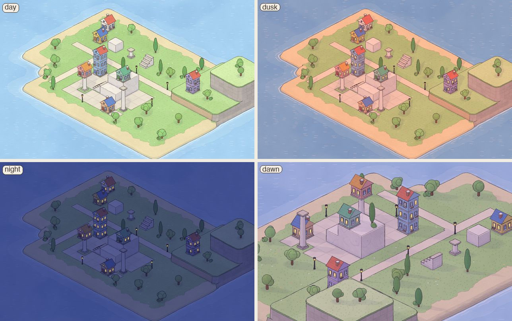

Time of day is a grade over the whole page: the drawing is tinted, the paper
darkens with it, the line stays the darkest thing. You do nothing for it,
with two exceptions.

- **Things that shine** must say so, or night will tint them like paint:
  window panes use `PATTERN.glass` (the shader lights windows one by one
  through dusk, leaves about one in seven dark, and gives them a warm halo);
  lamp glass and lanterns use `PATTERN.glow`. A behaviour can dim or flicker
  a prop with `instance.setParams(glow)` (1 is "as the time of day says", 0
  is off).
- **Check your piece at night.** `npm run shots -- <scenario> --time night`.
  Hue is muted then, so a piece that only separated its parts by hue turns
  into one blob. Separate by value and by outline.

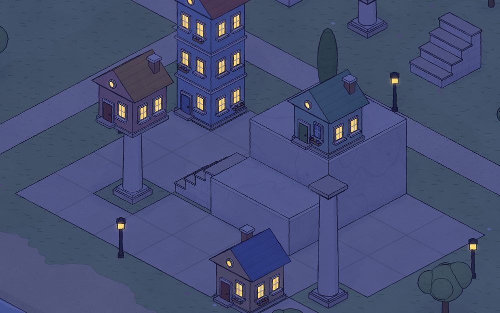

## 8. MeshBuilder idioms

```ts
const b = new MeshBuilder({ ink: s.id });                 // one builder per structure (parts: ctx.mesh())

// State, then shapes. `with` scopes a change; `at` scopes a transform.
b.with({ color: PALETTE.stoneShade, pattern: PATTERN.stone, ink: 'plinth' }, () =>
  b.boxAt([0, 0, 0], [0.92, 0.07, 0.92], { skip: ['bottom'] }));

// Build each piece round its own origin and place it: one face of a house, four times.
for (let k = 0; k < 4; k++)
  b.at(compose(rotationY((k * Math.PI) / 2), translation(0, 0, 0.43)), () => windowAt(b, `w${k}`));

// Round and smooth: a column, a trunk, a dome.   Faceted: a lamp cap.
b.lathe([[0.16, 0], [0.15, 1.3]], { segments: 16 });
b.at(rotationY(Math.PI / 4), () => b.lathe([[0.11, 0.75], [0, 0.83]], { segments: 4, smooth: false, capBottom: true }));

// A blob (fixtures/shapes.ts): a squashed ball. Crowns are a few blobs in ONE ink group,
// so the outline runs round the whole crown and the creases between blobs draw the leaf masses.
b.with({ color: leaf, pattern: PATTERN.leaves, ink: 'crown', sway: 0.85 }, () => {
  blob(b, 0, 0.5, 0, 0.26);
  blob(b, 0.14, 0.42, 0.05, 0.17);
});

// A merged mass: draw only the faces that border something else; mark top edges for the bevel.
b.box([x, y, z], [x + 1, y + CELL_H, z + 1], { only: openFaces, bevelTop: topIsOpen });

// Quads are counter-clockwise seen from outside. Back faces are not drawn.
b.quad([e, top, l], [e, top, -l], [0, top + rise, -l], [0, top + rise, l]);   // a roof slope facing +x
```

- **Sway**: 0 is rigid; crowns 0.8–1, bushes 0.3, awnings and flags 0.5–1 at
  the free edge and 0 where they are fixed (`setSway((x, y, z) => ...)`).
  The trunk's foot is always 0. The wind is one field for baked geometry and
  for behaviours, so a gust crosses trees and laundry together.
- **Budget**: about 1,000 triangles for a house storey with four windowed
  faces, 500–900 for a tree, 150 for a lamp. Triangles are cheap (a whole
  chunk is one draw call); the limit is the eye. Ink groups cost nothing.
- **Tests**: `validateMesh(mesh)` is `[]`, `findDuplicateFaces(mesh)` is 0,
  `inkGroups(mesh).size` is what you meant, `triangleCount(mesh)` is in
  budget (`src/gen/checks.ts`; `scenarios/look/look.test.ts` shows each).

## 9. Do and don't

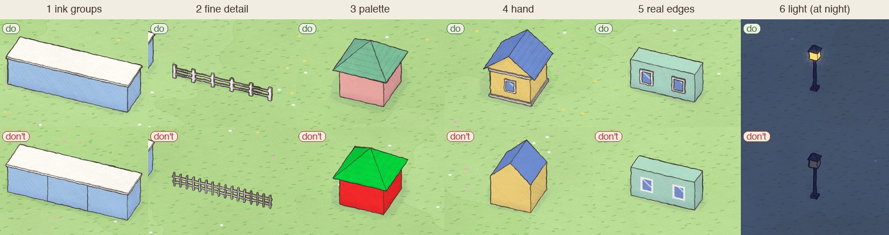

1. **Ink groups**: one surface, one group, no faces between merged cells.
   Not a group per cell: that draws a seam at every joint.
2. **Fine detail**: a few bold parts sharing a group. Not many thin parts
   with a group each.
3. **Palette**: palette colours and let the shader tone them. Not pure
   saturated colour, which reads as plastic.
4. **Hand**: plinth, trim, overhang, a window, a degree of lean. Not a bare
   box with a bare prism on it.
5. **Real edges**: a frame is its own object with its own group, standing
   0.03 proud. Not a patch of colour inside the wall's group, which gets no
   line.
6. **Light**: `PATTERN.glow` or `glass` for what shines. Not a bright vertex
   colour, which night turns grey.

Also: do keep silhouettes readable from all four sides (the door side is not
the only side); don't put detail only where the default camera sees it. Do
let a stack read as one building (one roof, one plinth, shared wall group);
don't repeat the plinth on every storey. Do end every piece on the grid;
don't let anything float (a gap of 0.01 is a visible line of sky).

## 10. Looking at your work

```sh
npm run shots -- <your scenario>                 # each camera, by day
npm run shots -- <your scenario> --time dusk     # and --time night
npm run shots -- 'look-*'                        # the reference pieces, to stand yours beside
```

The look scenarios (`scenarios/look/`) keep drawing the fixture pieces even
after real generators exist, so they stay a fixed reference. Every other
scenario draws what discovery found in `src/gen` and `src/parts`.

Before calling a piece done, look at it from the four orbit quarters
(below), close and far, by day, dusk and night, next to the fixture house
and tree, and score it against the rubric in the plan (silhouette, scale,
line, colour, hand, family, detail density). The page's own numbers (line
width, hatching, grain, the grade colours) are in `src/style/look.ts` and
can be tuned live in the gallery; they are the page's, not a piece's, so
change them only with the Look owner.

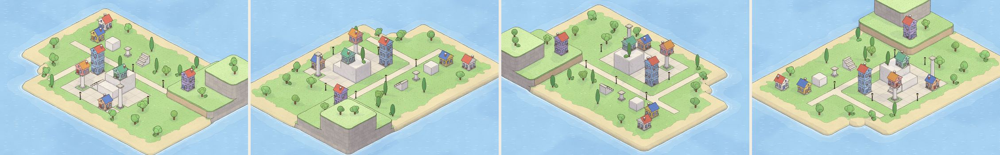

Terrain, for reference: rounded terraces, earth banks with a grass lip,
rock where the drop is two levels or more, a beach that slopes into the sea.

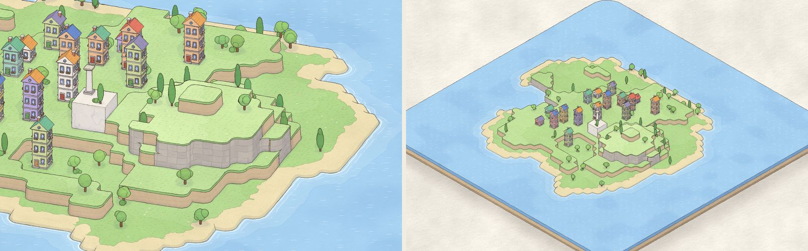

## 11. Grounding (the page does this; added after Stage 1)

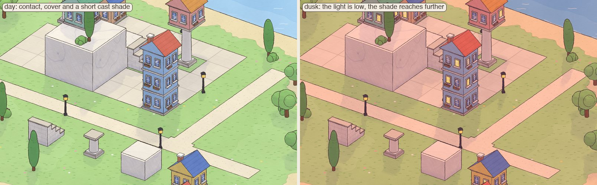

Pieces sit on the ground in a soft pencilled shade, drawn the way an
illustrator shades rather than the way a renderer casts shadows:

- **contact**: a darker, cooler tone hugging the foot of anything that
  stands on a surface, on every side;
- **cover**: whatever is under a crown, an arch, a deck, a house on stilts
  or an eave is in shade, with the outline of the thing above it;
- **cast**: a short shade on the side away from the light (north-west),
  with a wandering edge; longer at dusk, faint at night;
- **foot**: walls darken a little where they meet the ground and just under
  an overhang.

It all comes from one picture of the town's heights seen from straight
above, so it follows directly from your geometry:

- It sees the **highest surface over each point**, and nothing else. What
  matters is the outline of your piece from above, and how high it is.
- **Overhangs shade what is under them.** An eave 0.12 out gives the wall a
  band of shade under it; an awning shades the door; a bridge shades the
  water. Model them as real geometry and you get this free.
- **Things must still touch.** The shade is worked out from above, so it
  cannot tell that a piece hovers 0.01 over the ground: the gap still shows
  as a line of light under it. Keep feet on the ground.
- Thin things throw thin shade (a lamp post's is a pencil line). Do not
  thicken them to get more.
- Light beams and the ghost throw none. Props and actors do, like
  everything else.

Its strength is `LOOK.ground` and the light's angle by time of day is in the
`grade` style (`daySlope`, `duskSlope`, and so on); they are the page's.

The ghost preview, for reference: a wash of the piece's colours with pencil
lines where its ink lines will be.

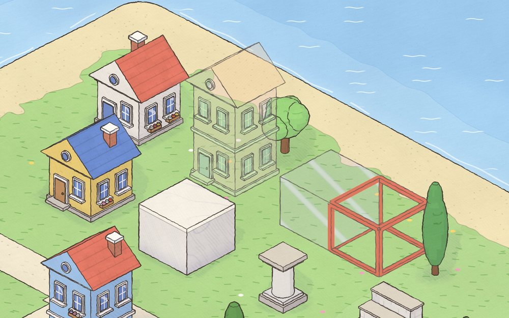

A generated island, by day and at dusk: lighter terraces, meadow patches,
the sea paling toward the shore in two contoured steps.

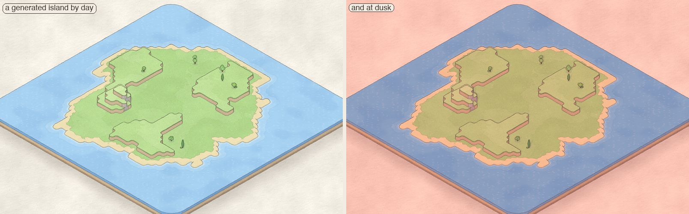
