# Art review 1: everything drawn in Stage 2

Reviewed at `33a2ef2` plus the new showcase `scenarios/core/everything.scenario.ts`
(`npm run shots -- everything`, add `--time dusk` or `--time night`). I rendered
all 117 scenarios by day, `everything` by day, dusk and night, and the showcase
and five galleries at double scale for the crops. Not judged, because other
agents are building them: lamps, laundry, flags and banners, people, boats,
motion, the lighthouse beam.

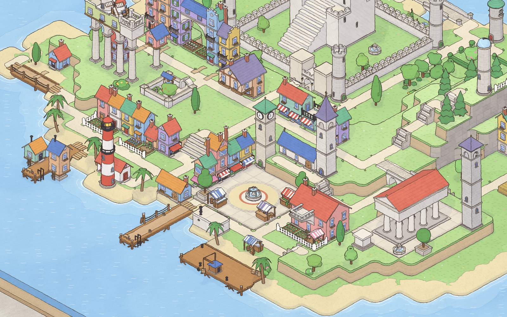

Dusk: `art/review-1/everything-dusk.jpg`. Night: `art/review-1/everything-night.jpg`.
Whole island: `art/review-1/everything-overview.jpg`.

## Verdict

It reads as one drawing by one hand, and it is already past the spike: the
shops, the stalls, the docks, the gardens, the lighthouse, the round towers
and the generated arcades would sit in the reference pictures without
apology. It is not yet at the references. They have no empty surface
anywhere, their trees and rocks are drawn rather than modelled, and nothing
in them looks like two parts that failed to meet. About a third of what is on
screen here fails one of those three tests. Nothing needs a redesign; all of
it is work on existing generators.

The three changes that close the most distance:

1. **No blank surface bigger than a cell and a half.** Marble walls, big hip
   roofs, the chapel, the temple entablature, the stairs block and bridge
   spandrels are flat tone with a pattern on it. The references put an object
   or a break (a course, a cornice, a buttress, a ridge, a window) on every
   such surface. This is the largest single gap, and it is why the castle,
   the biggest thing in town, is the weakest.
2. **Redraw the natural things as drawings.** Round crowns show flat facets
   with straight edges, pines are stacked folded cones, cliffs are a grid of
   grey slabs. These are the most repeated shapes in any town and they are
   the ones that say "3D model".
3. **Close the joins that look broken.** Railings hanging outside the wall
   they stand on, a balcony with no door, stilt houses on a stone column,
   buttresses that are planks, flues like factory stacks, trails like strips
   of card. Each is small; together they are what a person would call low
   quality.

## Scores

1 to 5 on the rubric's seven lines; 4 ships, under 4 must be fixed. Sil =
silhouette, Fam = family, Det = detail density.

| Family | Sil | Scale | Line | Colour | Hand | Fam | Det | |
|---|---|---|---|---|---|---|---|---|
| **Houses** | | | | | | | | |
| Cottage, row house, townhouse | 4 | 4 | 4 | 4 | 4 | 5 | 4 | ships once flues are fixed |
| Shop, inn front (awning, sign, bay) | 5 | 4 | 4 | 4 | 4 | 5 | 5 | the best thing in the set |
| Manor, inn and any roof over 3 × 3 | 3 | 4 | 4 | 4 | 3 | 4 | 2 | roof |
| Chapel | 4 | 4 | 4 | 4 | 3 | 4 | 2 | plain |
| Stilt house, boathouse | 3 | 3 | 4 | 4 | 3 | 3 | 3 | footing |
| Jettied room, cliff house, greenhouse | 4 | 4 | 4 | 4 | 4 | 4 | 4 | ships |
| Roof terrace | 4 | 2 | 3 | 4 | 3 | 4 | 4 | railing |
| Windmill | 4 | 4 | 4 | 4 | 4 | 4 | 4 | ships |
| **Monuments** | | | | | | | | |
| Lighthouse | 5 | 4 | 4 | 5 | 4 | 5 | 4 | ships |
| Round and square towers, all seven roles | 5 | 4 | 4 | 4 | 3 | 4 | 4 | ships; hand is thin |
| Marble mass: keep, gatehouse, terrace, quay wall, plinth | 4 | 3 | 4 | 3 | 2 | 3 | 2 | redo the walls |
| Temple | 4 | 4 | 4 | 4 | 3 | 4 | 3 | entablature |
| Stone bridge, viaduct | 4 | 4 | 3 | 3 | 3 | 4 | 3 | rings, spandrels |
| Sky bridge, gateway | 4 | 3 | 4 | 4 | 4 | 4 | 4 | gap at the wall |
| Flying buttress | 2 | 3 | 4 | 4 | 3 | 3 | 3 | reads as a plank |
| Loggia | 4 | 3 | 4 | 4 | 3 | 4 | 4 | no door |
| Pillars, generated pillars and arcades, brackets | 4 | 4 | 4 | 4 | 3 | 4 | 4 | ships |
| **Ground** | | | | | | | | |
| Docks: pier, quay, boardwalk, jetty | 4 | 4 | 4 | 4 | 4 | 5 | 4 | ships |
| Stalls | 5 | 4 | 4 | 4 | 4 | 5 | 5 | ships |
| Gardens: kitchen, wheat, herb, park | 4 | 4 | 4 | 4 | 4 | 4 | 5 | ships |
| Fountain, well, birdbath, basin | 4 | 4 | 4 | 4 | 3 | 4 | 4 | ships |
| Round, grove, fruit and planter trees, bush | 4 | 4 | 3 | 4 | 3 | 3 | 3 | facets |
| Pine | 3 | 4 | 2 | 4 | 2 | 2 | 3 | redo |
| Willow | 2 | 4 | 3 | 4 | 3 | 3 | 3 | redo |
| Palm, cypress | 4 | 4 | 4 | 4 | 4 | 4 | 4 | ships |
| Paths, plaza, carved steps | 4 | 4 | 4 | 3 | 3 | 4 | 3 | bare; loud motif |
| Stairs block | 3 | 4 | 4 | 4 | 2 | 3 | 2 | redo |
| Picket fence, rope fence, balustrade, garden wall | 4 | 4 | 4 | 4 | 3 | 4 | 4 | ships |
| Iron railing | 4 | 2 | 2 | 3 | 3 | 3 | 4 | too heavy, outside the wall |
| Curtain wall | 3 | 4 | 4 | 4 | 2 | 3 | 3 | loose teeth |
| **Look** | | | | | | | | |
| Terraces, grass, beach, sea | 4 | 4 | 4 | 4 | 4 | 4 | 4 | ships |
| Rock faces | 3 | 4 | 3 | 3 | 2 | 2 | 3 | slab grid |
| Day page | | | 3 | 4 | | | | line too heavy up close |
| Dusk page | | | 4 | 3 | | | | one salmon |
| Night page | | | 4 | 3 | | | | stone sinks into grass |

---

## Houses

### Must fix

**H1. Big roofs are empty.** A roof over about 3 × 3 cells (manor, inn, any
merged block) is one flat colour with faint shingle lines and nothing on its
ridge or hips. See `everything` `hill-and-mill` (manor), `gen.house-street`
`mid`, `J12.tower-collar` `close`.
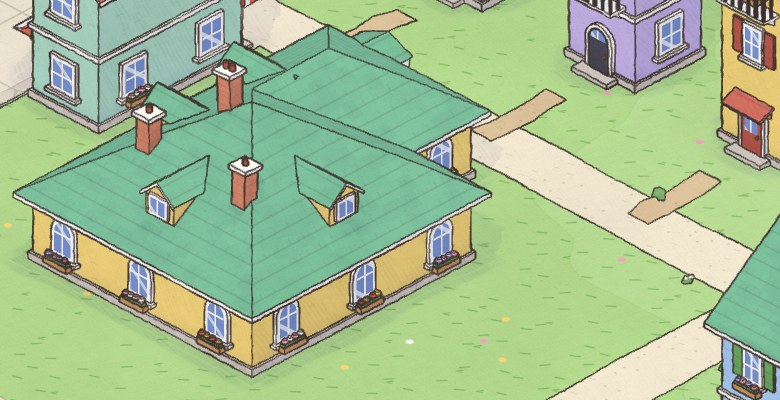
Right looks like: a raised ridge cap and hip caps (0.06 wide, 0.03 proud,
own ink group, a tone darker than the roof) on every roof; an eave fascia in
white; and no run of roof longer than 3 cells without an object on it. Take
them in this order until the run is broken: a cross gable over the main
door, dormers (raise J10 to p = 1 on runs of 4 or more), a second chimney, a
roof light, a weathervane. Vary tile tone in two or three seeded bands
(±6%), which the guide already allows.

**H2. The chapel is the plainest building in town and it stands next to the
best tower.** `everything` `close-chapel`, `R-H01.chapel` `close`.
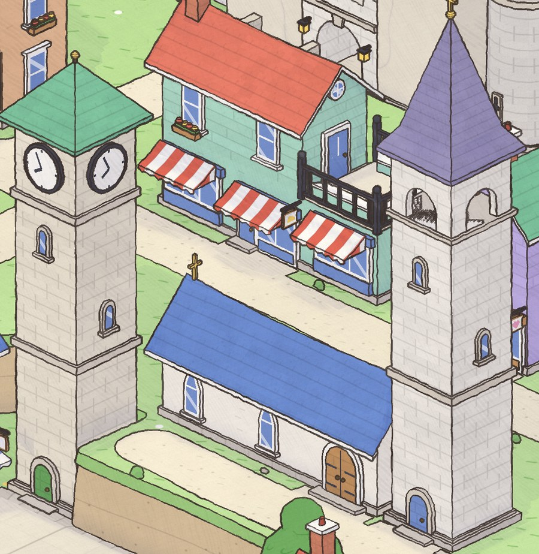
Right looks like: stepped buttresses between the windows (0.1 wide, 0.08
proud, stone shade, their own group); lancet windows twice the present
height, reaching to within 0.1 of the eave; a small gabled porch or a hood
over the double door; the rose window large enough to read at default zoom
(0.3 across) on the gable that faces away from the tower; a ridge crest and a
stone cross on the gable instead of a wooden one; a stone plinth course. No
flower boxes.

**H3. Tall flues read as factory stacks.** A 0.13 wide brick stick rising
more than a storey above its own roof. `everything` `close-shops`, the row
on the lower lane; `J11.chimneys` `close`.
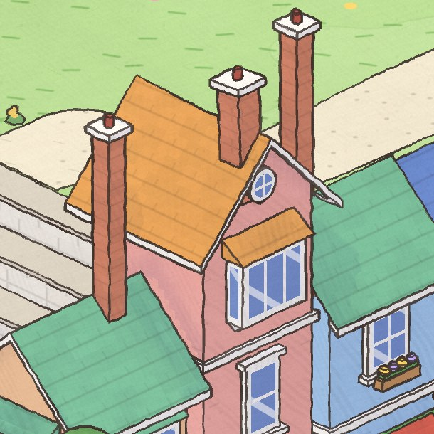
Right looks like: where the taller wall is a neighbour's, run the flue up
that wall as a brick breast 0.2 wide and 0.08 proud, ending 0.25 above the
neighbour's eave. Where it must stand free, at least 0.18 wide, a stepped
shoulder halfway, and never more than 0.8 above the roof it leaves. One per
party wall, not one per house.

**H4. Roof terrace: railing outside the wall, and two barriers at once.**
The player's railing stands on the cell line, 0.07 outside the house wall,
and the house also draws its own white parapet inside it. `everything`
`close-gate` (house east of the clock tower), `J05.roof-terrace`,
`ground-edges` `roofs`.
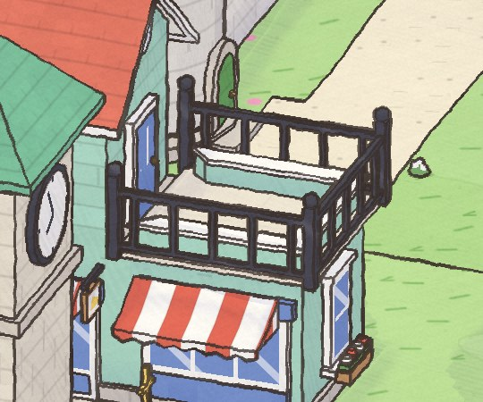
Right looks like one barrier standing on the wall head. Houses: leave the
parapet out on any side that carries an edge piece, and cap the wall there
with a 0.06 coping. Ground: see G4 (inset and lighter iron).

**H5. Trails look like strips of card.** A hard-outlined tan parallelogram
from door to path. `gen.house-street` `mid`, `J08.stoop-trail` `close`,
`everything` `upper-town`. Right looks like: no ink outline (put it in the
ground's ink group, or mark it un-inked the way `beam` is), a ragged edge,
width wandering between 0.25 and 0.4, the `dirt` pattern thinning into the
grass at both ends, a slight bend rather than a ruled line.

**H6. A loggia gets no door.** R-A05 promises one; `everything` has a loggia
on the inn at (31, 2, 33) and `inspect` shows no door on the wall behind
it. `everything` `viaduct` (bottom left), `R-A05.loggia`.
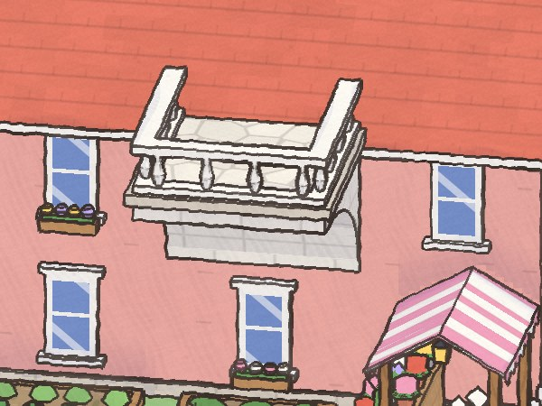
Right: J26 treats a loggia deck like any walkable arch deck and puts a
glazed door there.

**H7. Stilt houses stand on one stone column.** Seam with Monuments, see M6.
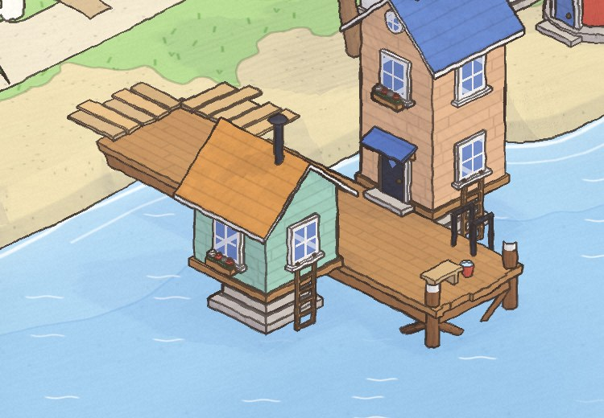

### Would be nice

- The ladders reported as placeholder markers are fixed: both stilt houses in
  `everything` `point` draw a timber ladder. Give it a second fixing so it
  does not lean off the wall.
- The foundation under a house on a slope (`J24.foundation` `close`) is a
  dark grey slab wall two storeys high. Batter it 0.04, use the tower's
  stone tone, and put one small opening or a buttress on any face wider than
  a cell.
- The tower collar (`J12`) is a flat white frame. A row of lead flashing
  following the roof slope would read better than a square.
- Ground-storey walls on long houses (the row in `R-H06.inn`) repeat one
  window at one spacing. Pair some, skip one in five.

---

## Monuments

### Must fix

**M1. Marble walls are blank.** The keep is fifty-nine cells of white with
faint veins, four slits and a crenellated edge. It is the largest object in
the showcase and has the least on it. `everything` `castle`, `castle-nw`,
`close-gate`; `gen.marble` `keep`; `R-M03.keep`.
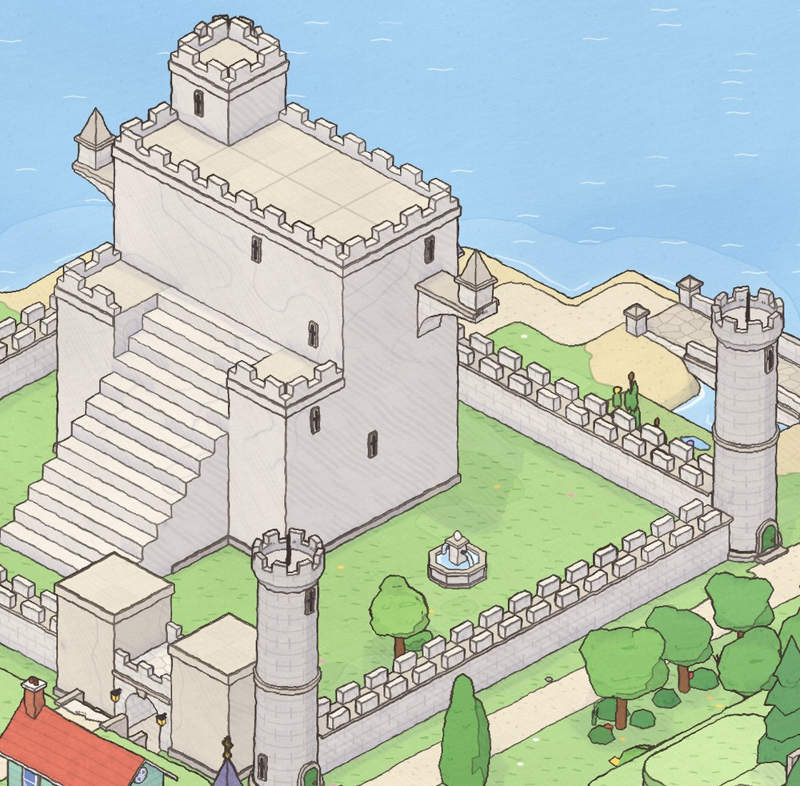
Right looks like:
- Keep the plinth at the foot and add a string course at every storey line
  (0.05 high, 0.03 proud, its own ink group). This alone gives the walls
  the pen lines they lack.
- **Castle roles (keep, gatehouse, quay wall) switch to the `stone` pattern**
  in the tower's tint, so the keep, its turrets and its curtain wall are one
  material. Veined marble stays for the temple, terrace, plinth and grand
  steps.
- Quoins at outer corners (alternating 0.14 and 0.09 blocks, 0.02 proud).
- A corbel table under the battlements of a keep (a row of small brackets,
  one group), so the top reads as oversailing.
- One opening per two cells of exposed wall per storey: slits on the lower
  storeys, a round-headed window with `glass` on the top one so the keep has
  light at night, and a door at the head of any grand steps.
- A handful of seeded stones a tone darker or 0.015 proud. Not noise: five
  or six per face.

**M2. Battlements.** Corner merlons are two pieces with a slit between
them, so every corner has a notch and a 1 × 1 top reads as four broken
prongs (`everything` `castle`, the keep's raised corner; the reported
inner-corner notch is the same fault). Also the two blocks either side of a
gatehouse arch are bare cubes beside a crenellated arch (`everything`
`castle-nw`, `close-gate`). Right: one L-shaped merlon per corner, inner and
outer, in the run's ink group; a gatehouse's flanking blocks get the keep's
battlements, a slit each and the courses of M1 whatever their height.

**M3. Arch ends stop short of what they join.** The arch generator ends on
the cell line; a house wall is 0.07 inside it and a round tower curves
away, and a sliver of whatever is behind shows through the join.
`everything` `folly` (sky bridge into both townhouses), `gen.arch`
`sky-bridge` and `buttress`. Right: every anchored end grows an impost block
(0.12 high, as wide as the arch, 0.03 proud of the arch face) that runs on
0.1 past the cell line into the anchor, so it buries in a house wall and
saddles a round tower. The covered gallery's wall and roof run on by the
same amount.

**M4. A flying buttress with no pier is a plank with a pinnacle on the end.**
`everything` `castle` (both sides of the keep), `gen.arch` `buttress`
(the one on the round tower).
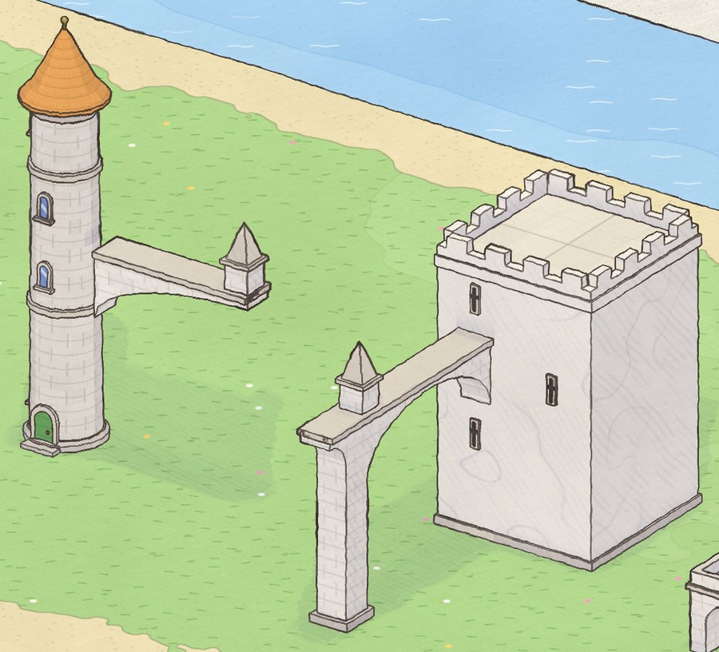
The one with a pier, on the right of the picture, is correct. Right for the
hanging one: a raking half arch, top edge falling from the anchor at about
30°, deep at the wall and thin at the tip, ending in a corbelled bartizan or
a pinnacle that hangs below the tip as well as standing above it. Never a
level slab.

**M5. Arches have no ring and bridges are flat grey.** `everything`
`bridge`, `viaduct`; `R-A01.stone-bridge` `low`; `R-A06.viaduct` `front`.
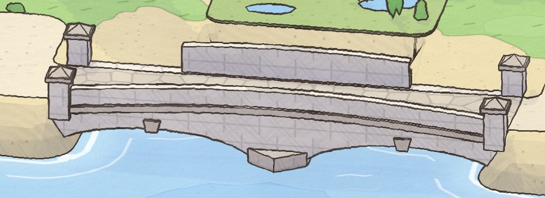
Right looks like: a voussoir ring 0.09 deep standing 0.02 proud round every
opening, in its own ink group, with a keystone 0.03 prouder; spandrels in
the `stone` pattern; the parapet a separate course with a coping; piers
with a cutwater where they stand in water. Give the bridge the tower's warm
stone, not a cooler grey than everything round it.

**M6. Generated supports ignore what they carry.** A stilt house (plank
walls, timber ladder) stands on a single stone column with a stepped
footing. `everything` `point`. Right: when the carried cell belongs to a
structure tagged `plank-walls` or sits within one cell of a dock, the S3
support is four timber stilts with one cross-brace per side, using the
dock's wood and its pile part, so the house and the pier beside it read as
one piece of carpentry. Houses supply the tag (it exists already).

**M7. Nothing on a monument is lit at night.** Clock faces, the keep and the
temple are dead after dark (`everything` `castle` and `close-chapel` at
night). Right: clock faces use `glow` at low strength; the windows from M1
use `glass`.

### Would be nice

- Temple: the entablature is a bare band and the tympanum is empty. Add
  triglyph blocks along the frieze (one group) and a round ornament in the
  pediment. `everything` `acropolis`, `art/review-1/monuments-temple.jpg`.
- Towers have almost no seeded variety: every band course and window sits
  at the same height on every tower. Shift windows ±0.02 and let one tower
  in three lean 0.01.
- Pillars: the generated ones are good. Add a slight entasis; they are
  ruler-straight cylinders.
- The pediment's gold finials are the only accent on the temple; a second
  small one (a painted cornice line) would help it at default zoom.

---

## Ground

### Must fix

**G1. Trees.** They are the most repeated object and the furthest from the
references, whose crowns are soft, round and plainly drawn.
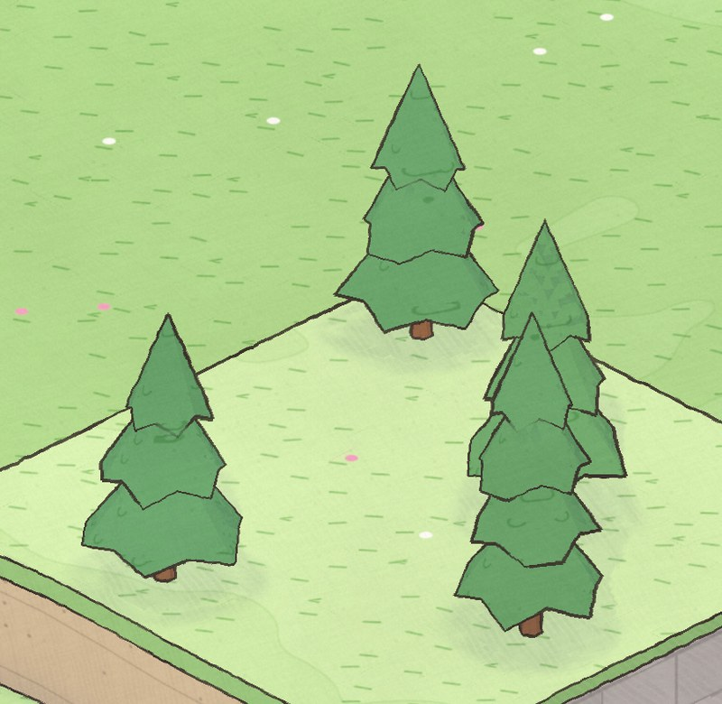
- **Round, grove, fruit and planter crowns** show flat polygons with straight
  edges (`everything` `castle`, right-hand grove; `ground-trees` `mix`).
  Right: smooth normals on every blob, sixteen or more segments, so the
  silhouette is a curve; a scalloped outline made by five to seven small
  blobs round the rim rather than three big ones; exactly two tones with a
  wandering boundary (the present light and half tone is the right idea,
  the straight facet edge is not); `leaves` marks clustered on the shade
  side only.
- **Pine**: stacked hard cones with folded ridges. Right: three or four
  drooping skirts, each a smooth lathe with a scalloped lower edge (eight
  to ten lobes, seeded), each skirt overlapping the one below by a third, a
  visible trunk at the foot, a slightly bent tip. Darker and bluer than the
  round trees.
- **Willow** reads as a mop (`ground-trees` `shore`). Right: a small round
  crown on a leaning trunk with eight to twelve separate hanging strands of
  differing length, gaps between them, full sway.

**G2. The stairs block is a stack of slabs.** No strings, no nosings, no
hand. `everything` `close-shops` (lower lane up to the high street),
`tray-pieces`.
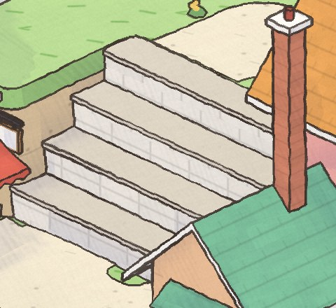
Right: a cheek wall on each open side (0.1 wide, top following the pitch,
ending in a small newel block), a nosing of 0.02 on every tread in the
lighter stone, treads varying ±0.01 in height and a degree in angle, one
tread in six chipped or a tone darker. Where a side meets a wall or a bank,
no cheek, and the treads run 0.07 into it.

**G3. The curtain wall's merlons are loose cubes on a kerb.** `everything`
`castle`.
Right: a continuous parapet band 0.12 high with a 0.03 overhang on a corbel
course, merlons 0.24 wide with 0.14 gaps standing on it, so the solid is
wider than the gap; a batter at the foot; a slit every third cell. Same
stone and courses as the towers. This and M1 together are what make the
castle read as a castle.

**G4. Iron railing.** It is the darkest and heaviest thing on the page: bars
and posts thicker than a window frame, solid `metal` black, so at default
zoom a roof terrace is a black box (`ground-edges` `roofs`, `everything`
`close-gate`, picture under H4). Right: bars 0.015, posts 0.03 with a small
ball finial, six bars to a cell, top rail only plus one low rail, all one
ink group. On a house roof it stands on the wall head: inset by the house's
0.07.

**G5. The plaza motif is a target.** A saturated red ring and a yellow disc
five cells wide breaks the palette rule on accents and pulls the eye from
anywhere on the island (`everything` `square`, `overview`). Right: the same
rings in two paving tones (`plaza` and `stoneShade`) with a thin `brick`
course between, radial joints, and the accent kept to a 0.1 line.

### Would be nice

- Paths are clean cream ribbons with a pen line each side. Break the line:
  ink only two thirds of each edge, let grass tufts cross it, add a worn
  centre tone and a few set stones at junctions.
  `art/review-1/ground-paths-grass.jpg`.
- J19 emits a single cell of picket at the cliff beside the observatory
  door (`everything` `hill-and-mill`). Either run it along the whole drop
  or not at all.
- Low walls and garden walls: coping stones of uneven length, one missing
  per run.
- Reed beds: the pools read as blue pebbles. Make them one or two larger
  irregular pools without an ink outline.
- The tiered fountain is small in a 5 × 5 square. A wider lower basin (0.9
  across) would hold the middle of the square.

---

## Look

### Must fix

**L1. Rock faces are a grid of grey slabs.** Every cliff of two levels or
more draws as large rectangular blocks in a cool grey, with a hard vertical
seam where rock meets earth. It reads as a concrete retaining wall and is
the least hand-made surface in the game. `everything` `hill-and-mill`,
`look-generated-2` `close`.
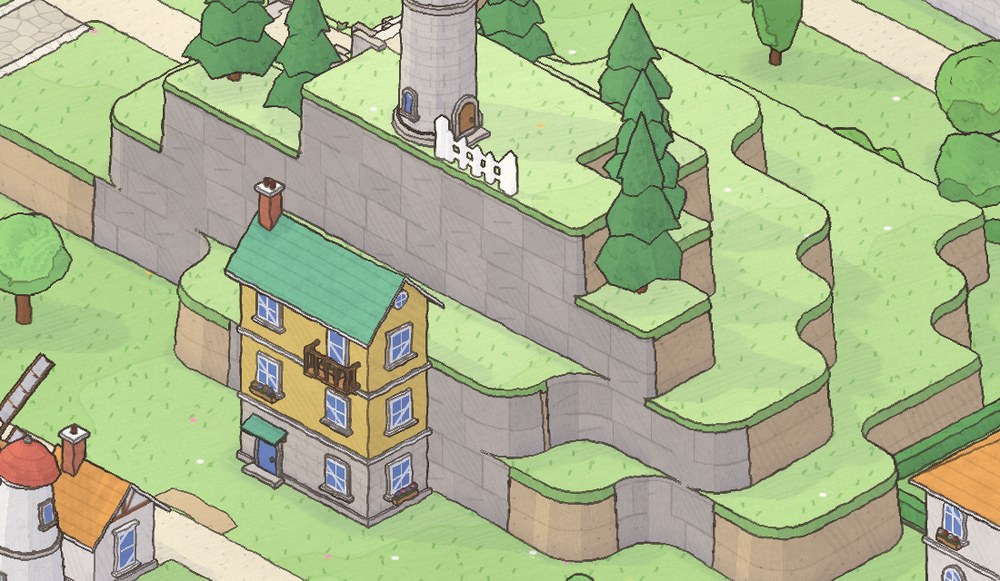
Right looks like: broken strata that follow the cliff, slanting a few
degrees and of uneven thickness; three or four long cracks per face instead
of a mesh; a warmer tone (toward `dirtDark`); one or two real ledges with a
grass lip partway up a tall face; rock and earth interleaving over half a
cell rather than meeting on a line.

**L2. The line is too heavy up close.** At playing zoom it is right. At the
zoom people use to look at a house (zoom 6 and beyond) every edge is the
same 1.6 pixel wobbling line and the picture turns from pen drawing to
sticker. The references keep a fine line and let the outline carry a little
more weight than what is inside it. Right: silhouettes stay near 1.5;
seams and creases get their own width of about 0.9. Check on `everything` `close-shops` and `close-chapel`.

**L3. Dusk is one colour.** The tint multiplies everything by the same
salmon, so stone, plaza, path and sand become a single tone and the town
loses its drawing (`art/review-1/everything-dusk.jpg`). Right: warm on faces
turned to the light, cool violet on faces turned away, and a paler tint
(nearer `#ffe6cc`) so the pale surfaces stay apart by value.

**L4. Night loses the monuments.** Stone, grass and sea land within a few
percent of each other; the keep and the temple vanish into the ground at
overview zoom (`art/review-1/look-night-overview.jpg`). Right: top faces and
pale materials take a moonlight lift so stone and white trim sit clearly
above grass, and the sea a step darker than the land.

### Would be nice

- Grass covers most of every frame in one saturated green. The references
  use a quieter sage. Take saturation down about a tenth and make the
  meadow patches twice as visible.
- Hatching is hard to find on pale stone. Raise it on surfaces lighter than
  the paper.

---

## Seams between owners

| Where | State | Owner | Note |
|---|---|---|---|
| Arch into a house wall or round tower | gap | Monuments | M3 |
| Railing on a roof terrace | outside the wall, doubled | Houses, Ground | H4, G4 |
| Loggia or balcony deck against a house | no door | Houses | H6 |
| Stilt house on a generated support | wrong material | Monuments, Houses | M6 |
| Keep, turrets and curtain wall | three different stones | Monuments, Ground | M1, G3 |
| Stairs block against a wall or bank | side left open | Ground | G2 |
| Battlements at inner corners | notch | Monuments | M2 |
| Tower through a roof | acceptable | Houses | collar is plain |
| Dock against a marble quay wall, dock ramp on a beach | good | | |
| Picket fence ending at a house, wall into a turret | good | | |
| Houses on marble, houses on pillars and arcades | good | | |
| Grand steps against the keep | good | | |

## The showcase

`everything` is the generator's island for seed 151 with 373 blocks: every
tray piece, 55 roles asserted in its `expect`, 25 cameras. It throws
at the first piece that no longer fits if the terrain generator changes. It
lists `houseDressing` (the stand-ins for D07, D09 and L03) in `rules`; take
that out when Stage 3's real rules land. Not in it: the lookout cottage
(the observatory took the top of the hill).
