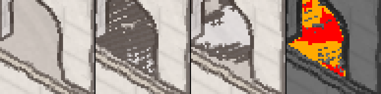
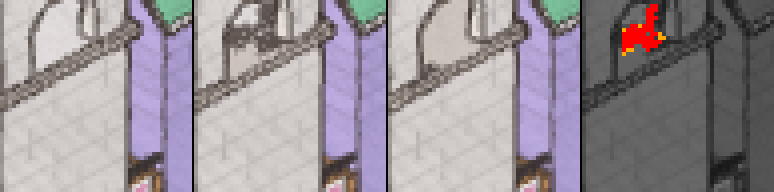
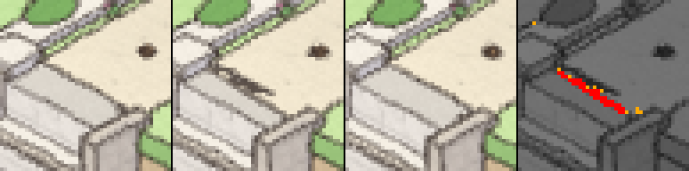
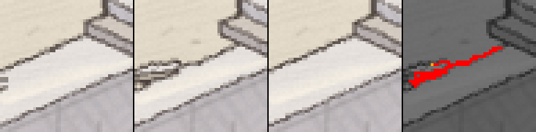
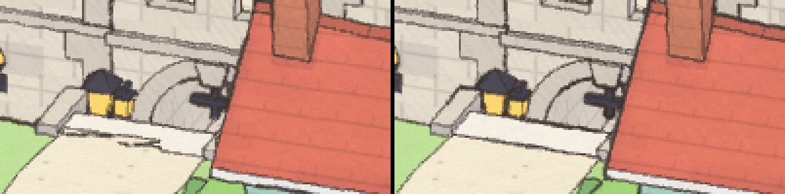

# Steady ink: flicker while the camera moves

The owner: "there are sometimes weird clipping issues with edges when you rotate the camera: I'm
rotating the camera and things flicker." Branch `swarm/steady-ink`.

## How it was measured

`src/render/testing/flicker.ts` (page side) and `flicker.mjs` (runner) draw a town from a run of camera
poses so close together that nothing on the page moves more than **a third of a CSS pixel** a frame
(yaw, pitch, zoom or a diagonal pan; life's clock held still). Anything the motion explains then stays
inside the 3 x 3 neighbourhood of where it was a frame before, so three scores count only what the
motion does not explain, per frame, in parts per thousand of the picture:

- **blink**: pixels darker (or lighter) by more than T than all of their neighbourhood both the frame
  before and the frame after: ink that appears for one frame, a line that drops out for one.
- **pop**: pixels outside their neighbourhood's range of the frame before by more than T (a face
  filling with ink, a line switching on or off and staying).
- **area**: 16 x 16 CSS-pixel blocks whose mean jumps by more than T/5.6 (large areas changing tone).
- **change** (not a flicker score): the mean change per pixel per frame; compared between two settings
  of one sweep it shows what a setting adds (the pen's wobble crawling, say).

T is 28% of the first frame's spread (at most 56 of 255; about 45 by day, 24 at night). The three
pixels at the frame's edge are left out (what comes into view there is new). Each run writes a heat
map and magnified crops of the worst regions (frames A | B | C | mask: red blinked, orange popped) to
`.context/flicker/<label>/`.

    node src/render/testing/flicker.mjs --label mine [--only substring] [--against before] [--style look.wobble=0]

Cases: `everything` and `grown-town-1`, at overview (zoom 1.6), playing (3.4 to 3.6) and close (7.5 to 8);
at each, yaw, pitch, zoom and pan by day at 1x (1280 x 800), yaw at night, yaw at 2x, and yaw on a phone
(390 x 844 at 2x, half-resolution ink); plus a close look at open sea. 40 frames each.
`--against before` scores with the thresholds of the run labelled `before`, so two versions of the view
are compared on equal terms. `--style` holds style values for a run, which is how causes were told
apart (ink seams off, silhouettes off, wobble off).

## What was found, by how much it showed

1. **Coplanar faces with different ink ids (z-fighting, seen through the ink).** By far the largest.
   Two faces in one plane, facing one way, overlapping (a tread flush with the path it laps onto, a
   belfry face flush with another, a pier top level with a plaza) traded pixels as the view turned:
   their colours are close, so the fight hardly showed in colour, but every traded pixel is an ink-id
   change and drew a seam. A face filled with scribble for a frame and emptied again. Switching seams
   off (`look.inkSeam=0`) took the blinks of a playing-zoom orbit from 0.050 to 0.003 per mille;
   silhouettes and creases off changed nothing. Pans did it too (a sub-pixel shift is enough).
   Even stills showed it: the scribble on the step's tread at `close-gate` below.

   
   
   
   

2. **Thin lines at 2x and on phones.** Where the picture is not super-sampled (1.5x and up, and the
   phone's half-resolution ink mask), ink was found from two sub-samples a quarter pixel apart. A seam
   or crease a pixel or less wide (window bars, pillar edges, railings) popped on and off as it crossed
   pixel centres. Playing-zoom orbit at 2x: blinks 0.20, pops 0.80, three to four times the 1x figures.

3. **The pen's wobble crawled.** Wobble, weight and density noise lived in a field fixed to the screen
   (it followed pans only), so every line slid through it as the view turned and boiled as it went.
   With the code before: an orbit changed the picture 23% more with the wobble on than off. It does not
   register as blinks (the noise is smooth); it is the "lines shimmer while I rotate" part.

4. **Wave marks slid over the sea.** The marks lay on a grid turned with the camera about the world's
   origin, so orbiting slid the whole field across the water, fastest far from the origin. Open-sea
   orbit: pops 0.31.

5. **Depth precision.** The camera's clip planes were 1 to 520 units; the depth buffer's step was
   3.1e-5 units, and the matrices measure depth from the eye 200 units away, where a float's rounding
   is a step. Not a visible cause by itself, but it set how finely the tie-break below could work.

Checked and **not** found to be causes:

- *Depth-jump ink on grazing surfaces.* The second difference of depth is zero on any flat face at any
  slant (the look's earlier fix); silhouettes off changed no score; no face filled with depth ink.
- *Literal clipping by the near or far plane.* Nothing was cut at any legal pose; `camera.test.ts` now
  checks it for the whole map, the paper and clouds out to where they come back in.
- *The grounding picture.* It is drawn from straight above in world space and only when the town
  changes, never with the camera; its texels are fixed to the ground.
- *Hatching and its zoom octaves.* On the surface since the look's earlier fix; the existing zoom test
  passes and the heat maps show nothing there.
- *Chunk culling, pool swaps, one-frame lag, damping overshoot.* Every pass of a frame uses that
  frame's camera; easing is exponential (no overshoot); culling spheres have a 2-unit margin; the
  heat maps show nothing at chunk borders or the frame's edge.
- *Paper grain.* It is fixed to the page on purpose (the drawing moves over the paper), and moves less
  than any threshold. Stars and the moon likewise.

## What was done

1. **Coplanar tie-break** (`shaders/surface.ts`, `index.ts` `Z_STEP`). Each ink id is drawn 0 to 23
   steps of 1.5 depth-buffer units nearer the eye (at most 5.3e-4 world units), chosen by a hash of the
   id. Of two faces in one plane the same one wins at every angle. Two ids land on the same level one
   time in 24; those pairs still fight (see the requests). The largest nudge stays below the depth
   between a detail and its face for every gap parts leave on purpose (0.004 and up at any pitch, 0.002
   from 16 degrees up).
2. **Clip planes pulled in** to 70 to 330 (`camera.ts`; was 1 to 520): what can be drawn and no more,
   tested. Depth steps are twice as fine. **Depth is worked out from the target** in the vertex shader
   (the same value the matrices give for an orthographic camera), where rounding is ten times finer.
3. **Four ink taps everywhere** (`shaders/composite.ts`). Seams and creases take four rotated
   sub-samples a pixel apart at every pixel ratio and in the phone's ink mask. Silhouettes keep two where
   the picture is not super-sampled (the other two would read the same depth texels), four where it is.
4. **The pen lives on the drawing** (`penAt`). Wobble, weight and density are read from a 3D noise at
   the world point under the pixel; across an outline the nearest surface within two pixels is used,
   so both sides of a line share one point. The scale follows zoom in blended powers of two, the finer
   octave of one zoom being exactly the coarser of the next (the hatching test caught a seam there).
   The noise is a 32-cube of random values read with hardware filtering at smoothed coordinates: one
   texture read per lookup. Still frames keep their wobble; under orbit the wobble adds no change of its
   own (change with wobble on 2.66, off 2.72; before, 3.33 on).
5. **Wave marks keep their place** (`waveMarks`). Each mark has a fixed cell of the water and is still
   drawn level on the page; one cell is read per layer, and a layer only where it shows.
6. **One generator fix** (one line): the carved steps' top tread sits `FLOOR.pathLift + 0.004`, a hair
   proud of the path it laps onto, instead of flush (`src/parts/ground/terrain-steps.part.ts`).

Tools added: `src/render/testing/flicker.{ts,mjs}`; `src/render/testing/coplanar.mjs` (lists
overlapping coplanar faces with different ink ids among structures and layers, by generator).
Requests to generator owners: `docs/swarm/requests/steady-ink.md`.

## Scores before and after

Per mille of the picture per frame; before is the code at `74ed19c`, after is this branch; after is
scored on the before run's thresholds (`--against before`). Lower is steadier.

| Case | Blink before | after | Pop before | after | Area before | after | Change before | after |
|---|---|---|---|---|---|---|---|---|
| everything-overview-yaw-day-1x | 0.007 | 0.005 | 0.082 | 0.065 | 0.01 | 0.01 | 1.64 | 1.42 |
| everything-overview-pitch-day-1x | 0.007 | 0.003 | 0.049 | 0.024 | 0.00 | 0.00 | 1.32 | 1.09 |
| everything-overview-zoom-day-1x | 0.008 | 0.006 | 0.075 | 0.064 | 0.02 | 0.00 | 1.64 | 1.55 |
| everything-overview-pan-day-1x | 0.019 | 0.020 | 0.131 | 0.124 | 0.00 | 0.01 | 2.62 | 2.60 |
| everything-overview-yaw-night-1x | 0.010 | 0.006 | 0.070 | 0.060 | 0.00 | 0.00 | 0.72 | 0.65 |
| everything-overview-yaw-day-2x | 0.070 | 0.020 | 0.261 | 0.134 | 0.01 | 0.00 | 1.88 | 1.59 |
| everything-overview-yaw-day-phone | 0.036 | 0.011 | 0.297 | 0.169 | 0.06 | 0.00 | 2.42 | 1.81 |
| everything-playing-yaw-day-1x | 0.078 | 0.019 | 0.358 | 0.206 | 1.31 | 0.17 | 3.38 | 2.65 |
| everything-playing-pitch-day-1x | 0.064 | 0.009 | 0.221 | 0.051 | 1.22 | 0.11 | 2.67 | 1.93 |
| everything-playing-zoom-day-1x | 0.067 | 0.018 | 0.331 | 0.195 | 1.24 | 0.16 | 2.88 | 2.52 |
| everything-playing-pan-day-1x | 0.063 | 0.031 | 0.394 | 0.331 | 0.79 | 0.12 | 3.60 | 3.60 |
| everything-playing-yaw-night-1x | 0.047 | 0.015 | 0.174 | 0.064 | 0.21 | 0.01 | 1.40 | 1.15 |
| everything-playing-yaw-day-2x | 0.201 | 0.062 | 0.799 | 0.188 | 1.07 | 0.10 | 3.93 | 2.96 |
| everything-playing-yaw-day-phone | 0.048 | 0.022 | 0.309 | 0.137 | 0.04 | 0.00 | 3.17 | 2.08 |
| everything-close-yaw-day-1x | 0.135 | 0.009 | 0.426 | 0.028 | 3.35 | 0.11 | 3.21 | 1.94 |
| everything-close-pitch-day-1x | 0.130 | 0.006 | 0.357 | 0.020 | 2.68 | 0.03 | 2.86 | 1.66 |
| everything-close-zoom-day-1x | 0.130 | 0.014 | 0.373 | 0.043 | 2.44 | 0.13 | 2.89 | 2.26 |
| everything-close-pan-day-1x | 0.420 | 0.015 | 0.607 | 0.040 | 3.42 | 0.13 | 2.91 | 2.82 |
| everything-close-yaw-night-1x | 0.101 | 0.006 | 0.310 | 0.018 | 1.18 | 0.03 | 1.31 | 0.86 |
| everything-close-yaw-day-2x | 0.216 | 0.017 | 1.106 | 0.066 | 3.00 | 0.09 | 3.87 | 2.20 |
| everything-close-yaw-day-phone | 0.031 | 0.004 | 0.374 | 0.028 | 0.06 | 0.00 | 2.51 | 1.11 |
| grown-town-1-overview-yaw-day-1x | 0.013 | 0.006 | 0.074 | 0.052 | 0.10 | 0.01 | 1.59 | 1.47 |
| grown-town-1-overview-pitch-day-1x | 0.011 | 0.006 | 0.047 | 0.030 | 0.04 | 0.02 | 1.09 | 1.13 |
| grown-town-1-overview-zoom-day-1x | 0.012 | 0.005 | 0.083 | 0.052 | 0.01 | 0.00 | 1.75 | 1.56 |
| grown-town-1-overview-pan-day-1x | 0.017 | 0.013 | 0.113 | 0.091 | 0.06 | 0.02 | 2.60 | 2.59 |
| grown-town-1-overview-yaw-night-1x | 0.014 | 0.010 | 0.073 | 0.058 | 0.00 | 0.00 | 0.72 | 0.65 |
| grown-town-1-overview-yaw-day-2x | 0.094 | 0.027 | 0.293 | 0.133 | 0.08 | 0.00 | 1.86 | 1.66 |
| grown-town-1-overview-yaw-day-phone | 0.079 | 0.026 | 0.373 | 0.212 | 0.58 | 0.12 | 2.36 | 1.93 |
| grown-town-1-playing-yaw-day-1x | 0.130 | 0.020 | 0.462 | 0.134 | 2.63 | 0.01 | 3.49 | 3.14 |
| grown-town-1-playing-pitch-day-1x | 0.148 | 0.009 | 0.414 | 0.052 | 3.05 | 0.00 | 2.42 | 2.42 |
| grown-town-1-playing-zoom-day-1x | 0.151 | 0.015 | 0.456 | 0.124 | 2.47 | 0.07 | 3.50 | 2.79 |
| grown-town-1-playing-pan-day-1x | 0.092 | 0.022 | 0.432 | 0.189 | 2.12 | 0.04 | 4.04 | 3.99 |
| grown-town-1-playing-yaw-night-1x | 0.104 | 0.031 | 0.334 | 0.106 | 0.52 | 0.02 | 1.44 | 1.31 |
| grown-town-1-playing-yaw-day-2x | 0.274 | 0.038 | 0.879 | 0.128 | 2.21 | 0.00 | 4.07 | 3.54 |
| grown-town-1-playing-yaw-day-phone | 0.181 | 0.022 | 0.624 | 0.175 | 2.26 | 0.06 | 2.91 | 2.27 |
| grown-town-1-close-yaw-day-1x | 0.135 | 0.004 | 0.357 | 0.025 | 3.17 | 0.13 | 2.40 | 1.94 |
| grown-town-1-close-pitch-day-1x | 0.214 | 0.008 | 0.508 | 0.022 | 4.04 | 0.07 | 1.83 | 1.77 |
| grown-town-1-close-zoom-day-1x | 0.161 | 0.007 | 0.465 | 0.032 | 3.67 | 0.05 | 2.96 | 1.88 |
| grown-town-1-close-pan-day-1x | 0.186 | 0.011 | 0.389 | 0.048 | 3.77 | 0.15 | 2.82 | 2.74 |
| grown-town-1-close-yaw-night-1x | 0.107 | 0.002 | 0.268 | 0.008 | 0.92 | 0.10 | 0.93 | 0.78 |
| grown-town-1-close-yaw-day-2x | 0.182 | 0.006 | 0.656 | 0.109 | 2.62 | 0.03 | 2.76 | 2.18 |
| grown-town-1-close-yaw-day-phone | 0.209 | 0.002 | 0.614 | 0.029 | 2.61 | 0.04 | 2.50 | 1.85 |
| everything-sea-yaw-day-1x | 0.038 | 0.026 | 0.313 | 0.064 | 0.00 | 0.00 | 0.32 | 0.16 |

Means over the 43 cases: blink 0.103 to 0.015 (-86%), pop 0.357 to 0.091 (-74%), area 1.37 to 0.05
(-96%). No case got worse.

The browser suite holds it (`src/render/view.e2e.test.ts`, "turning the camera round a town does not
make the ink flicker, and the pen does not crawl"): a close orbit and tilt of `everything` at 640 x 400
must stay under blink 0.06, pop 0.3, area 0.8 per mille (the old code: 0.13 / 0.50 / 2.5 and
0.07 / 0.27 / 1.7; now about 0.02 / 0.14 / 0.1 and 0.01 / 0.05 / 0.1); a playing-zoom orbit under
area 0.2 and pop 0.25 (old 0.32 and 0.17, now 0.065 and 0.13); and the wobble may add at
most 8% to an orbit's change (the old pen added 52% at that size). The old code fails it.

## What it costs

Whole frame (CPU and GPU, synced by a pixel read) while orbiting `everything`, alternating the old and
new code, on a machine under load 4 to 15: 1280 x 800 at 2x, 6.1 / 7.8 ms before and 7.3 / 8.5 ms after
(about **+1 ms**: the four taps are nearly all of it; the pen and the sea are a tenth of a millisecond
or less since they read textures instead of hashing); a phone (390 x 844 at 2x, half-resolution ink),
2.5 ms before and 2.5 to 2.8 after. `npm run bench`: 60 fps, 14 draw calls, unchanged.

## The look

All 25 cameras of `npm run shots -- everything`, before and after, compared by eye and by numbers: the
share of ink-dark pixels moves by at most 0.2 points either way (5.59% to 5.64% at `close-shops`, 3.22%
to 3.02% at `folly`) and mean brightness by under 0.5 of 255. The pen still wobbles, swells and thins;
grain, stepped tones and hatching are untouched; the sea's marks are as many and as level, without the
rows the old grid laid them in. Where the old code showed a coplanar fight even in a still, the after
picture is cleaner:

Judged as good or better.

## What is left

- **Coplanar pairs whose ids share a level** (1 in 24) still fight. Their seams blink. The real fix is
  in the geometry; the pairs found are listed for their owners in `requests/steady-ink.md`.
- **Near-vertical seams under a slow pan** step in quarters of their weight as they cross the
  super-sampled picture's texels (pillar edges, window frames: the largest remaining pop, playing-zoom
  pan 0.33). It reads as a slightly stepped edge, not a blink. Finer would mean ink found at a higher
  resolution than the picture, at a cost.
- The paper grain stays fixed to the page by design.
